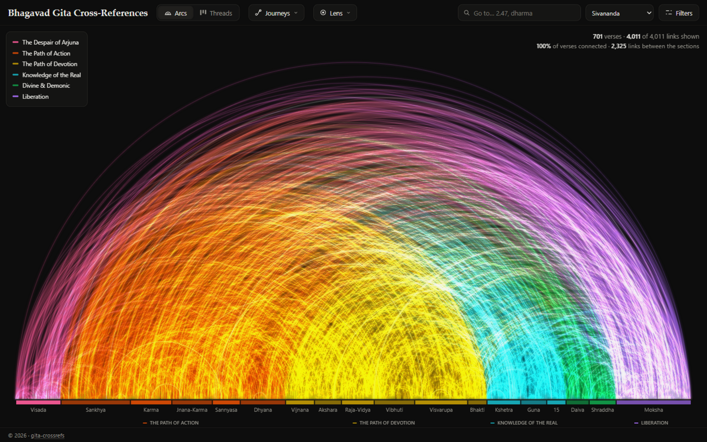
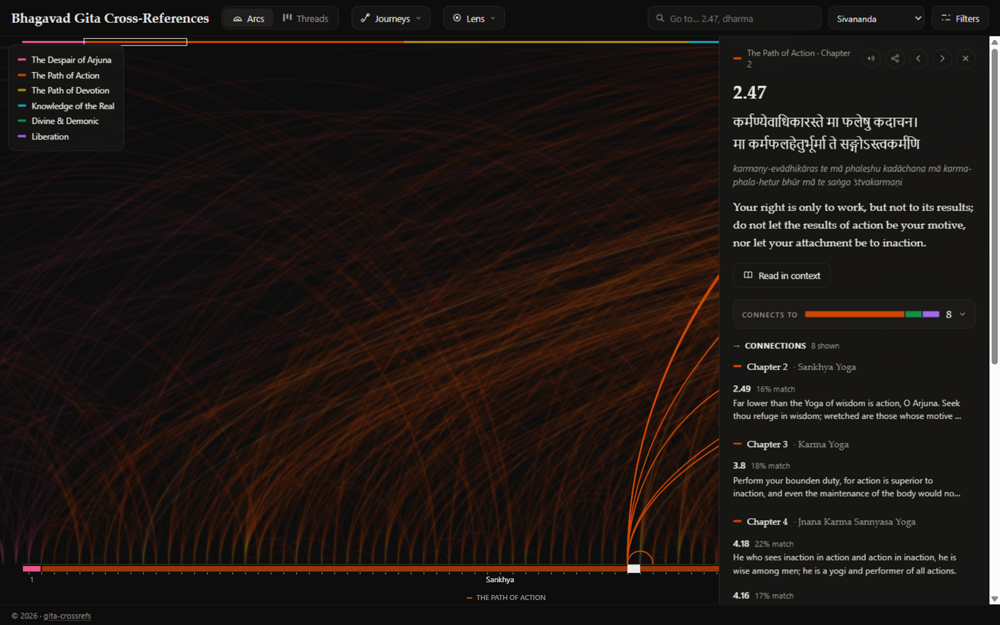

# Bhagavad Gita Cross-References

<p align="center"></p>

**All 701 verses of the Bhagavad Gita on a single line — and the 4,011 threads that bind them together.**

An interactive visualization of the thematic connections between the verses of the
Gita, and rebuilt from
scratch in plain Canvas 2D — no framework, no build step, no dependencies.


<p align="center"></p>


## What's inside

**Two views**

- **Arcs** — the whole Gita as a dome: scroll to zoom, drag to pan, click a verse to
  focus it. Chapter bars and labels below, mini overview strip when zoomed.
- **Threads** — pick a chapter, read its verses as a list, and watch their connections
  flow to the chapters they touch, one thread per link.

**Study tools**

- **Verse panel** — Sanskrit (Devanagari), IAST transliteration, translation, a
  "connects to" distribution strip, and connections grouped by chapter with match strength
- **Word-by-word concordance** — every verse's glosses become clickable chips; click
  *mat-manāḥ* and find every verse using that word
- **Commentary** — Śaṅkarācārya (original Sanskrit) and Swami Sivananda (English) per verse
- **Recitation** — 🔊 plays the verse's Sanskrit audio (streamed on demand)
- **7 translations** — 6 English voices + Hindi (Swami Ramsukhdas), switchable and remembered

## Run it locally

```bash
cd app
python -m http.server 8123     # open http://127.0.0.1:8123/
```


